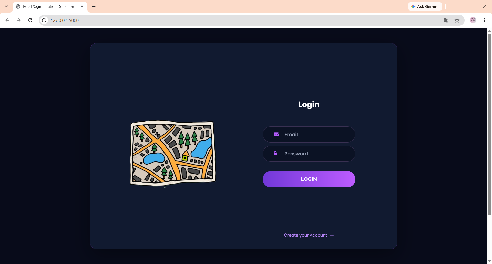
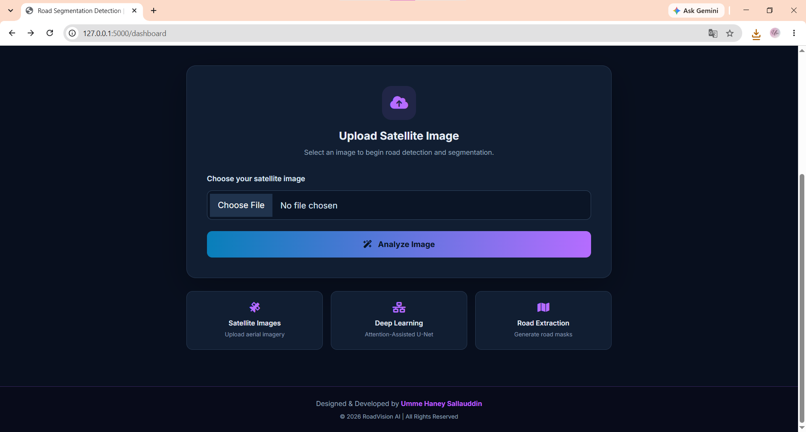
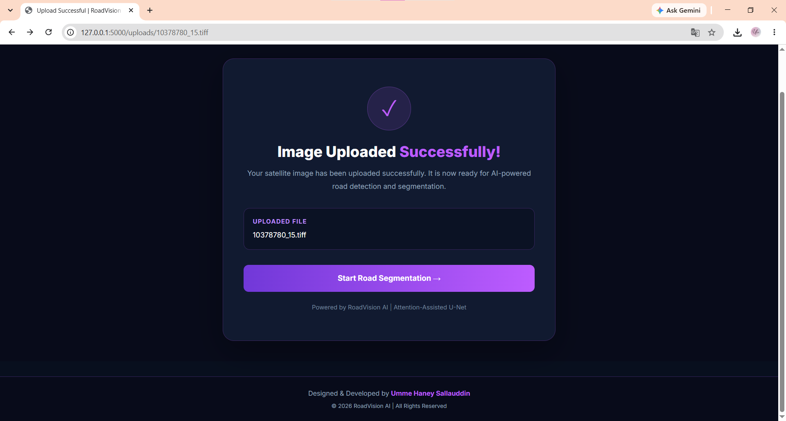
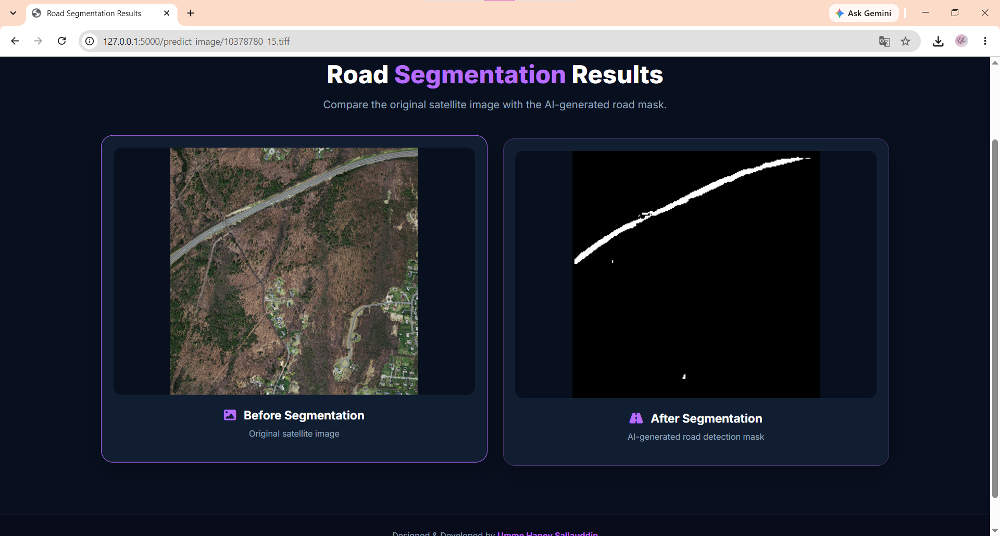

# RoadVision AI 🛰️

### AI-Powered Road Segmentation from Satellite Images

RoadVision AI is a deep learning-based web application that identifies and extracts road networks from satellite images using an Attention-Assisted U-Net architecture.

The application allows users to upload satellite images and view the AI-generated road segmentation mask.

## 🚀 Features

- User login and registration
- Upload satellite images
- AI-based road detection and segmentation
- Attention-Assisted U-Net model
- Before-and-after image comparison
- Visual road segmentation results
- Flask-based web interface

## 🧠 Model Architecture

- Architecture: Attention-Assisted U-Net
- Encoder: ResNet34
- Attention mechanism: scSE
- Framework: PyTorch
- Dataset: DeepGlobe Road Extraction Dataset

## 🛠️ Technologies Used

| Category | Technologies |
|---|---|
| Programming | Python |
| Deep Learning | PyTorch |
| Model Architecture | U-Net, ResNet34, scSE |
| Image Processing | OpenCV, NumPy, Pillow |
| Web Framework | Flask |
| Frontend | HTML, CSS, JavaScript, Bootstrap |
| Version Control | Git and GitHub |

## 📁 Project Structure

```text
RoadProject/
│
├── app.py
├── predictions.py
├── Train_Data.py
├── Train_Data_backup.py
├── best_model.pth
├── requirements.txt
├── .gitignore
│
├── templates/
│   ├── base.html
│   ├── index.html
│   ├── dashboard.html
│   ├── success.html
│   └── output.html
│
├── static/
│   ├── images/
│   ├── js/
│   ├── output/
│   ├── res/
│   └── uploads/
│
└── testImages/
```

## ⚙️ Installation and Setup

### 1. Clone the repository

```bash
git clone https://github.com/umme-haney19/RoadVision.git
cd RoadVision
```

### 2. Create a virtual environment

```bash
python -m venv .venv
```

### 3. Activate the virtual environment

Windows:

```bash
.venv\Scripts\activate
```

### 4. Install dependencies

```bash
pip install -r requirements.txt
```

### 5. Run the application

```bash
python app.py
```

### 6. Open in browser

```text
http://127.0.0.1:5000
```
## 📸 Project Screenshots

### Login Page


### Dashboard


### Upload Success Page


### Road Segmentation Results


## 🖼️ Application Workflow

1. Login or register.
2. Open the dashboard.
3. Upload a satellite image.
4. The trained deep learning model processes the image.
5. View the original image and predicted road segmentation mask.

## 📊 Model Performance

The model was trained for 40 epochs using the DeepGlobe dataset.

Best validation IoU achieved: **0.2995 (29.95%)**.

Performance may vary depending on image quality and road characteristics.

## 🔮 Future Improvements

- Improve road segmentation accuracy.
- Reduce false-positive road predictions.
- Add interactive road network visualization.
- Deploy the application online.
- Improve model performance with additional training.

## 👩‍💻 Developer

**Umme Haney Sallauddin**

GitHub: https://github.com/umme-haney19

## 📄 License

This project is licensed under the MIT License.
